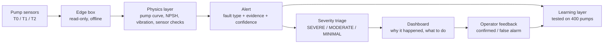

# ZeroFault: technical overview

ZeroFault watches an existing cooling-water pump, raises an alert when a fault develops, names the fault from pump physics, shows the evidence and recommends what a human should do. It only reads data: no hardware writes, no control.

On the challenge's validation pumps it scores **95.8 / 100** (best baseline 78.0): **9 of 9 faults detected, 8 of 9 named correctly, zero false alarms**. On old pumps with only legacy sensors it drops to 61.5, and the measurements show why: those pumps do not record the signals the faults leave behind. A low-cost retrofit kit closes that gap and pays for itself in about six months.

## 1. How the system fits together

| Layer | What it does | Status |
|---|---|---|
| Physics detector (`diag2.py`) | raises and names every alert, causal, deterministic | built, submitted |
| Learning layer (`learn_model.py`, `alarm_model.py`) | learns fault naming and alarm timing from labelled data | built and tested; does not beat physics yet, so physics decides |
| Severity triage | SEVERE / MODERATE / MINIMAL from fault type and physics evidence (`fault_actions.json`) | defined, dashboard wiring in progress |
| Dashboard | evidence ("why did this happen?"), action steps, urgency | in progress (zerofault.help) |
| Optional local LLM | turns alerts and operator notes into a shift-handover summary; never detects or classifies | optional |

## 2. The data and the three sensor tiers

12 simulated pumps (ship seawater and fresh-water cooling, cooling towers, hot process water), 7 days each at 1 Hz, plus 4-hourly vibration recordings. Train PUMP-01..07, validation PUMP-08/09, hidden test PUMP-10/11/12.

| Tier | Sensors | Example |
|---|---|---|
| T0 legacy | discharge pressure, motor current, temperatures (speed and power only with a drive) | PUMP-03, 05, 11 |
| T1 low-cost retrofit | T0 + suction pressure + wireless vibration and bearing temperature (every 5 min) + vibration recording every 4 h | PUMP-01, 06, 08, 10 |
| T2 full | T1 + flow, power, winding temperature, valve position, wired vibration every second | PUMP-02, 04, 07, 09, 12 |

## 3. Physics methods

Every rule is a physical law or a datasheet value, not a fitted number per pump, so it carries over to pumps it has never seen.

| Method | Physics | Faults it finds |
|---|---|---|
| Pump curve + affinity laws | head ~ speed^2, power ~ speed^3. Head factor = measured head / datasheet head at the measured flow. 1.0 = healthy. | restriction (head up, power down), impeller wear (head lost over weeks), air (head lost within hours) |
| NPSH margin | (suction pressure + 101.3 kPa - boiling pressure of the water from the Antoine equation + velocity head) / NPSH required. Below 1.15 the water boils at the inlet. | cavitation, clogging that leads to it |
| Vibration recordings | bearing index = bearing-frequency envelope / high-frequency energy (healthy ~0.1, damaged > 0.6). 2x line = shaft misalignment, 1x line = imbalance, two recordings in a row. | bearing wear, misalignment, imbalance |
| Sensor vs machine | a real fault moves physically linked signals together; one signal moving alone is a sensor fault. Current is checked against power (current = no-load current + k x power); bearing temperature against water temperature. | drift, calibration shift, stuck, noise spikes, communication loss |
| Warm-up | temperatures need about 2 h after a start (thermal time constants 20-40 min), so they are ignored in that window | removes restart false alarms |

Every alert carries its evidence in plain numbers, for example "NPSH margin 0.62 < 1.15 for 10 min (water near boiling at inlet)" or "2x vibration x5.2, twice-per-turn wobble = shaft misalignment".

## 4. Learning methods (what we tried and what we learned)

We generated **400 extra pumps** with the challenge simulator (`make_dataset.py`, 67 random seeds) and split them by batch: 70 % to learn, 10 % to tune, 20 % kept as an exam the models never saw.

| Learning approach | Data | Result on the exam pumps | Decision |
|---|---|---|---|
| Fault-naming model (gradient boosting on physics features of each alert) | ~280 pumps of alerts | 70.19 vs physics 70.21; names 4 more faults correctly | safe, but no score gain |
| Alarm model (learns minute by minute when a fault is visible) | 325,000 labelled minutes | finds 6-14 more faults but triples false alarms; 69.4 vs 71.2 | not used |
| Learning curve | 21 -> 79 -> 280 pumps | from 3-6 points worse than physics to equal | learning works, data quality is the limit |

What this told us: physics already captures what the sensors can reveal. The learning layer is ready for the data that will make it pay off: real operator feedback (confirmed fault / false alarm) collected through the dashboard and stored in the database (`schema.sql`).

## 5. The hybrid: how the parts combine

1. **Physics raises and names every alert.** Deterministic, explainable, runs on a ~EUR 500 edge box offline at sea.
2. **Strong physics evidence always wins** (NPSH margin < 1.15, bearing index > 0.6, data gap). The learning layer may only change a fault name when it is very sure (>= 85 %) and physics was unsure.
3. **Severity comes from the fault type**, not from the confidence number: cavitation and air entrainment = SEVERE (hours), clogging, restriction, mechanical wear and sensor faults = MODERATE (work order or instrument ticket), weak alerts = MINIMAL.
4. **Feedback closes the loop.** Every operator confirmation or rejection becomes a labelled example; the learning layer retrains on it and is only switched on when it beats physics on held-out pumps.

## 6. Results across different pumps

**Against the challenge baselines** (official scorer, out of 100):

| Method | Train | Validation |
|---|---|---|
| B0 SCADA alarms | 27.6 | 23.1 |
| B2 CUSUM | 53.3 | 50.9 |
| B3 Isolation Forest | 39.4 | 69.2 |
| B1 mode-aware z (best baseline) | 58.2 | 78.0 |
| **ZeroFault physics** | **84.5** | **95.8** |

**The same validation pumps with sensors removed:**

| Sensors | Faults caught | Faults named right | False alarms / pump-day | Score (B1) |
|---|---|---|---|---|
| T2 full | 100 % | 89 % | 0 | **95.8** (78.0) |
| T1 retrofit | 100 % | 88 % | 0 | **95.2** (72.3) |
| T0 legacy | 67 % | 50 % | 0.21 | **61.5** (38.5) |

**Unseen simulated pumps:** on 102 new pumps ZeroFault beat B1 in 16 of 17 batches (65.4 vs 57.5); the latest version scores 73.8 on 15 held-out batches.

## 7. Why T0 pumps are the weak spot

The T0 gap is a sensor problem, not a software problem:

- **No vibration sensor:** bearing wear, misalignment and imbalance leave almost no trace in pressure and current.
- **No suction gauge:** cavitation and clogging look like "discharge pressure changed a bit"; the NPSH margin cannot be computed.
- **No flow meter:** the pump-curve check (head factor) is impossible, so impeller wear that is already present is never found.
- **About 1 in 5 faults on T0 pumps leaves no measurable signal at all** (marked unobservable in the data). No model, physics or machine learning, can find what is not measured.

We tested this directly: removing the T1 sensors from the validation pumps drops the score from 95.2 to 61.5 and adds false alarms. More rules and two machine-learning models on 400 pumps did not close the gap.

## 8. Adding sensors: the money

Challenge business-case model (`examples/business_case.py`) with our measured detection rates, per pump per year:

| Setup | Faults caught early | False alarms / day | Net effect per year | Payback |
|---|---|---|---|---|
| Physics on a T0 pump (no new sensors) | 67 % | 0.21 | -EUR 3,842 (false alarms cost more than the repairs saved) | never |
| Physics + retrofit kit (T1) | 100 % | 0 | **+EUR 8,600** | **about 6 months** |

The kit (wireless vibration sensor, suction pressure transmitter EUR 145-288, temperature sensor, energy meter, edge computer) costs about EUR 2.1-2.4 k in hardware, about EUR 4.5 k installed. Each fault caught early turns a 10-hour breakdown into a 3-hour planned stop and a EUR 9,000 repair into a EUR 4,000 one.

Assumptions from the challenge model: 0.6 faults per pump per year, EUR 1,500/h downtime, no standby pump. On ships with a standby pump, the saving comes mainly from cheaper repairs, so payback takes longer.

## 9. Honest limits

- All results are on the organiser's synthetic data; a real pilot starts in read-only shadow mode.
- Validation has only 2 pumps (9 faults); the 400-pump tests are the fairer measure for new pumps.
- Bearing faults on T1 are confirmed at the next 4-hourly recording (about 1 day late).
- Slow drift and sudden calibration shift are sometimes confused.
- Confidence values are rule strengths, not calibrated probabilities.

## 10. Talking points for the technical minute (about 60 seconds)

1. "The best baseline names the right fault only 44 % of the time. We built a detector on pump physics instead."
2. "It uses the pump's own datasheet: the pump curve, the boiling point of the water at the inlet, and the vibration fingerprint of each fault. Every alert says why, in numbers."
3. "On validation it scores 95.8 against 78: every fault caught, zero false alarms. It also beats the baseline on 400 pumps it has never seen."
4. "We trained two machine-learning models on those 400 pumps. They matched physics but didn't beat it, so physics decides, and the models learn from real operator feedback over time."
5. "Old pumps are the limit: without vibration and suction sensors some faults leave no trace. A EUR 4.5 k retrofit kit fixes that and pays back in about six months."

## Files

`diag2.py` detector · `pipeline.py` data -> dashboard files · `lab2.py` score vs B1 · `generalisation_test.py` sensor-tier and unseen-pump tests · `learn_model.py`, `alarm_model.py` learning experiments · `dashboard_data/` alerts, time series, `fault_actions.json` · `SUBMISSION.md` run instructions and limitations
